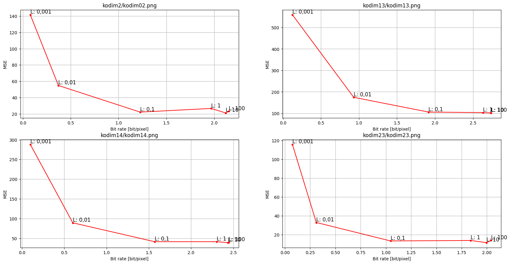
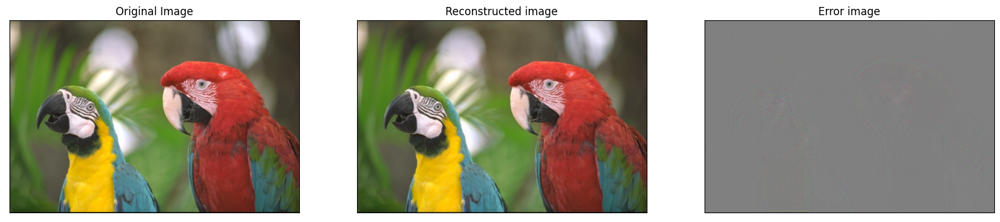
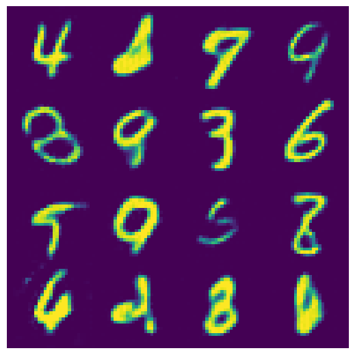

# AI-Based Image Compression

Course project for *Multimedia Information Coding and Description*, M.Sc. in Communication Technologies and Multimedia, University of Brescia (2023).

The project studies **End-to-end Optimized Image Compression** (Ballé, Laparra and Simoncelli, ICLR 2017): an autoencoder with a learned entropy model, trained on a rate–distortion objective (R + λD). During training, quantization is replaced with additive uniform noise, which makes the model closely related to a variational autoencoder.

## Contents

### `bls2017_analysis/`: the BLS2017 model
- Compressed four Kodak images with BLS2017 models for six values of λ (0.001 to 100), computed rate (bits per pixel) and distortion (MSE), and plotted the rate–distortion curves.
- Extracted and visualized the feature maps after each analysis and synthesis stage (convolution + GDN).

`bls2017.py` is the model script from [tensorflow/compression](https://github.com/tensorflow/compression) (Apache 2.0). I added a function that saves the intermediate features. The analysis is in `performance_study.ipynb`. The trained models are not included, because of their size.

### `toy_examples/`: a small compression model
Based on the TensorFlow [Learned data compression](https://www.tensorflow.org/tutorials/generative/data_compression) tutorial:
- Trained a small compression model on MNIST with different values of λ.
- Tested it on cat images (CIFAR-10 and a cat/non-cat dataset).
- Generated new samples by decoding latents drawn from the learned prior.

The cat/non-cat `.h5` dataset is not included.

### `presentation/`
Slides presented for the exam.

## Requirements
Python, TensorFlow, [TensorFlow Compression](https://github.com/tensorflow/compression), TensorFlow Datasets, OpenCV, Matplotlib.

## References
- J. Ballé, V. Laparra, E. P. Simoncelli, "End-to-end Optimized Image Compression", ICLR 2017.
- J. Ballé et al., "Nonlinear Transform Coding", IEEE Journal of Selected Topics in Signal Processing, 2021.
